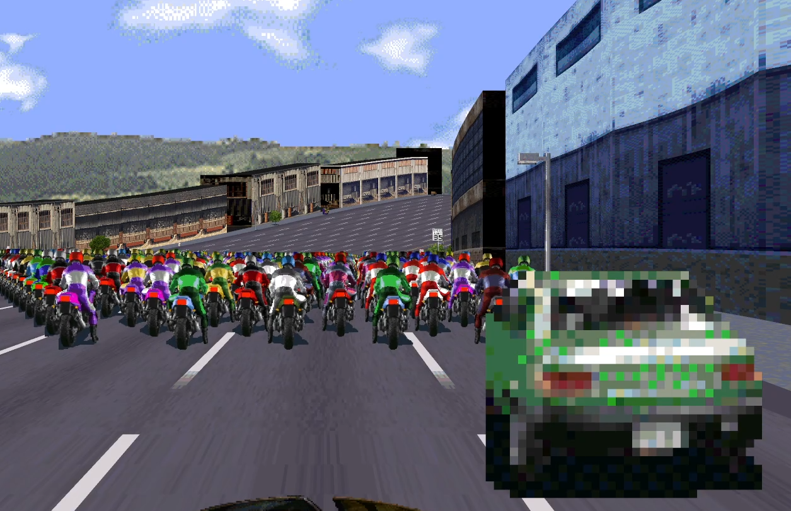

# 暴力摩托增强启动器 0.5.0

用于 Windows 10/11 x64 上的 Steam《Road Rash：30 周年纪念版》，已验证游戏 build **26105967**。本版加入击倒仪表、连击火焰、硬核模式和「我是警察」预设。

## 安装与使用

1. 解压玩家版 ZIP，将 `暴力摩托增强启动器.exe` 和整个 `Tools` 文件夹放在 `RoadRash95.exe` 旁。升级时保留自己的 `launcher_settings.ini` 和语音库。
2. 打开中文启动器，选好玩法，点击 **应用并启动**。玩家包自带 .NET 桌面运行库和增强器 v1.1.0。
3. 在「画面设置 → 击倒仪表」调整归因时间、连击时间和播报间隔。在「比赛设置」开启硬核模式或选择「我是警察」。可选语音的安装命令见[玩家指南](docs/launcher-readme.txt)。

| 功能 | 本版行为 |
| --- | --- |
| 击倒与连击 | 五位液晶表统计本场击倒。默认在最后一次命中或接触后 2 秒内归因，18 秒内连续击倒显示火焰标语。 |
| 英文播报 | 默认每次有效击倒触发。Holy Shit 与 Rampage 只在通道空闲时播放。 |
| 硬核模式 | 玩家首次摔车触地 3 秒后以撞毁出局，暂停期间停表。 |
| 我是警察 | 玩家使用警用摩托与警棍，硬核模式锁定。倒地的参赛 AI 退出本场。 |
| 其他玩法 | 支持骑行、车辆、泥头车和长跑，可调整比赛规模、赛道、车流、武器、AI 和音效。 |



## 开发与验证

在 Windows 上准备 .NET 10 SDK 和系统自带的 .NET Framework 4.x 编译器。首次构建需要还原 NuGet 依赖。以下命令从源码根目录运行，将示例游戏路径替换为本机路径。

```powershell
$gameDir = 'D:\Games\RoadRash'
.\scripts\build.ps1
.\scripts\test.ps1 -GameDirectory $gameDir
.\scripts\test-wpf.ps1 -RenderUi -GameDirectory $gameDir
```

构建产物位于 `artifacts/bin/`。WPF 测试使用离屏界面；带游戏目录的桥接测试从已有增强器备份基线创建隔离副本，验证读取、应用与还原。界面、补丁与兼容进程的职责见[工作台架构](docs/wpf-workbench.md)。

**0.5.0 收尾验证（2026-11-20）**：单中文入口的解压包通过 147 项界面检查，隔离副本应用补丁后可还原到原始哈希。比赛规则专项通过 86 项检查，涵盖两条触地路径、暂停和重开；模拟声卡分别连续触发 50 次 Holy Shit 与 Rampage，停止击倒后均无积压补播。上述结果来自离线测试。完整赛程和实际扬声器听感仍需实机确认。

## 生成分发包

打包需要 Python 3.9+。在构建完成后运行以下命令生成玩家版、源码 ZIP 及各自的 SHA-256 校验文件。

```powershell
py -3 .\scripts\package.py --player-enhancer "$gameDir\Tools\RoadRash30thEnhancement-v1.1.0.exe"
```

脚本核对增强器摘要后将输出写入 `artifacts/release/`。省略 `--player-enhancer` 可生成需另备增强器的独立启动器包；`--source-only` 仅打包源码。本机已验收的分发件存放在游戏目录的 `Release/`。玩家包随附语音导入脚本，玩家自己的音库、存档和配置保存在本机。

## 专题文档

| 查找内容 | 文档 |
| --- | --- |
| 安装、玩法、语音、设置还原及日志 | [玩家指南](docs/launcher-readme.txt) |
| 连击火焰、游戏调色板、DirectDraw 合成与离屏复核 | [击倒仪表绘制](docs/knockdown-sprites.md) |
| 长跑范围、选线、恢复上车、车辆耐久和下车保护 | [长跑与比赛设置](docs/long-run.md) · [车手功能](docs/character-features.md) |
| 历次功能、修复与兼容性记录 | [变更记录](CHANGELOG.md) · [2026-11-17 兼容性记录](docs/compatibility-2026-11-17.md) |
| 第三方工具、原始文件校验与许可 | [依赖清单](dependencies/README.md) · [第三方说明](THIRD_PARTY.md) |
| 源码许可与参与开发 | [MIT 许可证](LICENSE) · [贡献指南](CONTRIBUTING.md) |

## 适用范围

单人比赛可配置最多 10000 人，属于实验规模，表现取决于硬件和赛道。车辆外观使用原有交通资源和摩托物理。赛程覆盖使用已有道路，公里数按实测比例换算。其他游戏版本、Wine、Proton 和 Steam Deck 尚未验证。
